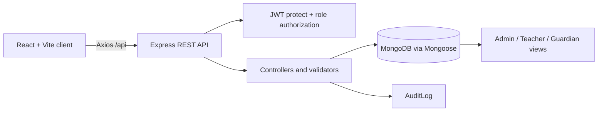

# SCHOLARA

Premium school management system for ALGIONS AI LABS PRIVATE LIMITED, built as a JavaScript-only MERN application.

## Overview

SCHOLARA centralizes school operations that are commonly split across spreadsheets and disconnected tools: student and teacher administration, academic structures, attendance, examinations, fees, guardian access, reporting, and auditability. The application uses server-side authorization and MongoDB-backed workflows rather than frontend-only or mock CRUD.

## Implemented capabilities

- JWT authentication with bcrypt password hashing and role-based access control.
- Admin dashboard, student CRUD, teacher CRUD and assignment management.
- Guardian directory and secure student linking.
- Class, section and subject management.
- Attendance recording, duplicate prevention, history and summaries.
- Examination scheduling, configurable grading rules, marks entry and report cards.
- Fee structures, invoices, partial/full simulated payments, receipts and reconciliation.
- Unified guardian portal for linked students, attendance, results and fees.
- Admin reports for students, attendance, examinations and fees.
- Admin-only paginated audit logs.
- Input validation, teacher assignment restrictions, guardian privacy controls and per-user bearer-token revocation on logout.

## Role capabilities

| Role | Capabilities |
|---|---|
| Administrator | Manage users, students, teachers, classes, sections, subjects, examinations and fees; view all attendance; access reports and audit logs. |
| Teacher | View assigned academic data; record and update attendance for assigned class/sections; access assigned examination rosters and submit marks for assigned subjects. |
| Guardian | Read-only access to linked students, attendance, examination results/report cards, invoices, payments and receipts. |

There is no student authentication role in the current implementation.

## Technology stack

- **Frontend:** React 18, Vite, JSX, React Router, Axios, Tailwind CSS, Framer Motion, Lucide React, Recharts, React Hook Form and React Hot Toast.
- **Backend:** Node.js, Express, Mongoose, MongoDB, JWT (`jsonwebtoken`), bcryptjs, express-validator, Helmet, CORS, cookie-parser and Morgan.
- **Testing:** Jest and Supertest for the backend; Vitest, Testing Library and jsdom for the frontend.
- **Language:** JavaScript and JSX only. No TypeScript configuration or source is used.

## Architecture

The React/Vite client communicates with the Express REST API through Axios. Express routes apply authentication and role middleware before controllers access Mongoose models. MongoDB stores operational data, while controllers enforce ownership, assignment, calculation and reconciliation rules.



See [docs/ARCHITECTURE.md](docs/ARCHITECTURE.md) for detailed flows and relationships.

## Installation

### Prerequisites

- Node.js and npm.
- MongoDB locally or a MongoDB Atlas connection.
- Git.

```powershell
git clone https://github.com/Sarthak3131/SCHOLARA-School-Management-System.git
Set-Location SCHOLARA-School-Management-System
Set-Location server
npm install
Copy-Item .env.example .env
```

Edit `server/.env`. Required values are documented in [server/.env.example](server/.env.example). `JWT_SECRET` must be at least 32 characters and must be unique in production. Set `MONGODB_URI` to the local or Atlas database, and set `CLIENT_URL` to the frontend origin.

Install the frontend in a second terminal:

```powershell
Set-Location client
npm install
```

## Running

Terminal 1:

```powershell
Set-Location server
npm run dev
```

Terminal 2:

```powershell
Set-Location client
npm run dev
```

The frontend is normally available at `http://localhost:5173`; the API health endpoint is `http://localhost:5000/api/health`.

### Seed data

The verified seed script creates demo users and sample classes, subjects, faculty, students, attendance, invoices and audit records:

```powershell
Set-Location server
npm run seed
```

The intentionally documented demo credentials are:

| Role | Email | Password |
|---|---|---|
| Administrator | `admin@scholara.edu` | `Admin@123` |
| Teacher | `teacher@scholara.edu` | `Teacher@123` |
| Guardian | `guardian@scholara.edu` | `Guardian@123` |

These are development/demo credentials only. Change or remove them before production use.

## Testing and build

```powershell
Set-Location server
npm test

Set-Location ..\client
npm run test -- --run
npm run build
```

Latest verified checkpoint results are recorded in [PROJECT_PROGRESS.md](PROJECT_PROGRESS.md) and [docs/TESTING_AND_SECURITY.md](docs/TESTING_AND_SECURITY.md).

## API documentation

The implemented REST endpoints are listed in [docs/API_DOCUMENTATION.md](docs/API_DOCUMENTATION.md). There is no mounted `/api/docs` Swagger endpoint in the current application; the installed Swagger packages are not used by the Express app.

## Project structure

```text
Algions/
├── client/
│   └── src/
│       ├── components/     Reusable UI and layout
│       ├── context/        Authentication context
│       ├── pages/          Role and feature pages
│       ├── services/       Axios API services
│       ├── styles/         Design system styles
│       └── test/            Frontend tests
├── server/
│   ├── src/
│   │   ├── config/         Database configuration
│   │   ├── controllers/    Request handlers
│   │   ├── middleware/     Authentication and errors
│   │   ├── models/         Mongoose schemas
│   │   ├── routes/         REST route definitions
│   │   ├── utils/          Tokens, seed and response helpers
│   │   └── validators/     Request validation
│   └── tests/              Backend integration tests
├── docs/                   Architecture, API, setup and testing guides
├── PROJECT_PROGRESS.md
└── README.md
```

## Screenshots

No repository screenshots are currently available. Capture real screens manually for a final presentation: login, admin dashboard, student management, teacher management, attendance, examination/marks entry, fee management, guardian portal, reports and audit logs. Do not represent generated or mock images as application screenshots.

## Limitations and future improvements

- There is no separate student login role.
- Payments are simulated; no payment gateway is integrated.
- JWT revocation is per-user token version, so logging out invalidates that user's active bearer tokens rather than one individual token.
- Dependency audits currently report low/moderate development-toolchain advisories; no force upgrades were applied.
- No license has currently been specified for this repository.

## Contribution

Create a focused branch, preserve the JavaScript-only architecture, reuse existing services/controllers/components, add regression tests for behavior changes, run both suites and the production build, update relevant documentation, and submit a reviewable commit. Never commit `.env`, credentials, tokens, `node_modules`, build output or coverage.
